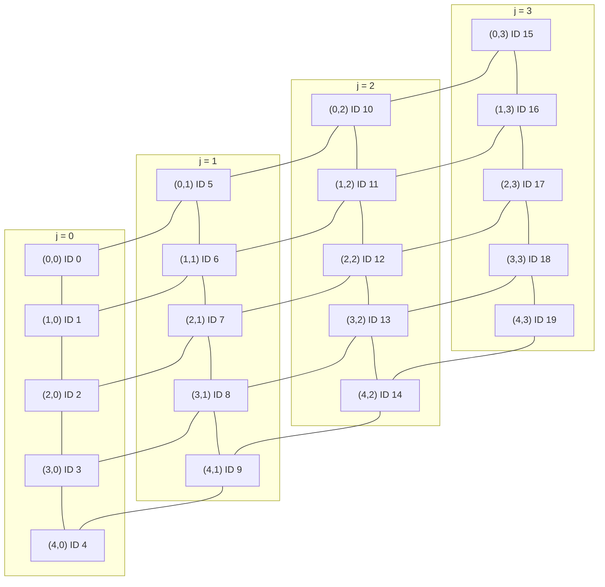

#

## Summary

## Mathematical Model

> **How to read this section.** It goes from the simplest idea (replace a derivative by a difference of numbers) to the full time-dependent convection-diffusion problem. Each part builds on the previous one, so read it in order. Every part ends with a worked example or a "remember" box.

**Contents**

0. [The big picture](#0-the-big-picture)
1. [Finite Difference Method (FDM)](#1-finite-difference-method-fdm)
2. [Finite Volume Method (FVM)](#2-finite-volume-method-fvm)
3. [Time marching (unsteady problems)](#3-time-marching-unsteady-problems)
4. [Cheat sheet](#4-cheat-sheet)

---

### 0. The big picture

#### 0.1 What are we trying to solve?

We want to know how some quantity $\Phi$ (temperature, concentration, a velocity component, ...) is distributed in space, and possibly in time. Only two things can move $\Phi$ around:

| Mechanism | Plain meaning | Math term |
|---|---|---|
| **Convection** (advection) | $\Phi$ is carried along by a flow, like a leaf on a river | $\nabla\cdot(\vec v\,\Phi)$ |
| **Diffusion** | $\Phi$ spreads from high to low values, like a drop of ink in water | $\nabla\cdot(\Gamma\nabla\Phi)$ |

Add a **source** $Q$ (heat generated, mass injected, ...) and a **storage** term $\partial\Phi/\partial t$ and you get the **General Conservation Equation**:

$$\underbrace{\frac{\partial\Phi}{\partial t}}_{\text{unsteady}} + \underbrace{\nabla\cdot(\vec v\Phi)}_{\text{convection}} = \underbrace{\nabla\cdot(\Gamma\nabla\Phi)}_{\text{diffusion}} + \underbrace{Q}_{\text{source}}$$

The Navier-Stokes momentum equation has the same shape, with $\Phi = u$, $\Gamma = \nu$ and the pressure and gravity terms acting as sources:

$$\frac{\partial u}{\partial t} + u\frac{\partial u}{\partial x} + v\frac{\partial u}{\partial y} = -\frac{1}{\rho}\frac{\partial P}{\partial x} + g_x + \nu\left(\frac{\partial^2 u}{\partial x^2} + \frac{\partial^2 u}{\partial y^2}\right)$$

This is why learning to solve this one equation is the foundation of CFD.

#### 0.2 Why numerical methods?

These equations rarely have a closed-form solution on real geometries. The numerical recipe is always the same:

1. **Discretize** the domain: cut it into a grid of points (FDM) or small cells (FVM).
2. **Replace** each derivative or integral by algebra on neighbouring grid values.
3. **Assemble** one equation per grid point or cell and solve the resulting linear system $A\vec\Phi = \vec b$.

The two methods in this document differ only in step 2.

| | Finite Difference (FDM) | Finite Volume (FVM) |
|---|---|---|
| Unknowns live at | grid **points** (nodes) | cell **centres** |
| Starting from | the differential equation | the **integral** (conservation) form |
| Key tool | Taylor series | divergence theorem |
| Strength | simple to derive | conserves the quantity exactly, handles awkward meshes |

#### 0.3 Notation used throughout

| Symbol | Meaning |
|---|---|
| $\Phi$ | the unknown quantity |
| $K$ (or $\Gamma$) | diffusion coefficient |
| $u, v$ | velocity in $x$ and $y$ |
| $Q$ | source term |
| $\Delta x, \Delta y$ | grid spacing (when equal, just $\Delta$) |
| $\Phi_i$ | value at node $i$: $\Phi(x_i)$, with $x_{i\pm1} = x_i \pm \Delta x$ |
| $\Phi_{i,j}$ | value at node $(i,j)$ in 2D |
| $\Phi^n_i$ | value at node $i$ at time step $n$ |
| $E, W, N, S, C$ | East, West, North, South neighbour and the Centre cell (FVM) |

---

### 1. Finite Difference Method (FDM)

#### 1.1 The idea

A derivative is a slope. On a grid we only know $\Phi$ at discrete points, so we **estimate the slope from neighbouring values**.

#### 1.2 Three ways to approximate a first derivative

$$\text{Forward:}\quad \frac{d\Phi}{dx}\approx\frac{\Phi_{i+1}-\Phi_i}{\Delta x}\qquad
\text{Backward:}\quad \frac{d\Phi}{dx}\approx\frac{\Phi_{i}-\Phi_{i-1}}{\Delta x}\qquad
\text{Central:}\quad \frac{d\Phi}{dx}\approx\frac{\Phi_{i+1}-\Phi_{i-1}}{2\Delta x}$$

#### 1.3 Where they come from: Taylor series

Expand $\Phi$ around $x_i$:

$$\Phi_{i+1} = \Phi_i + \Phi'\,\Delta x + \Phi''\frac{\Delta x^2}{2} + \Phi'''\frac{\Delta x^3}{6}+\dots$$

$$\Phi_{i-1} = \Phi_i - \Phi'\,\Delta x + \Phi''\frac{\Delta x^2}{2} - \Phi'''\frac{\Delta x^3}{6}+\dots$$

**Forward difference.** Rearrange the first line:

$$\frac{\Phi_{i+1}-\Phi_i}{\Delta x} = \Phi' + \underbrace{\Phi''\frac{\Delta x}{2}+\dots}_{\text{truncation error}\;=\;O(\Delta x)}$$

We throw away the error term. The scheme is **first-order accurate**: halving $\Delta x$ halves the error. The backward difference works the same way from the second line.

**Central difference.** Subtract the second line from the first. The $\Phi''$ terms cancel, leaving

$$\frac{\Phi_{i+1}-\Phi_{i-1}}{2\Delta x} = \Phi' + O(\Delta x^2)$$

It is **second-order accurate**: halving $\Delta x$ cuts the error by 4.

**Second derivative.** Add the two lines. The $\Phi'$ terms cancel:

$$\boxed{\frac{d^2\Phi}{dx^2}\approx\frac{\Phi_{i+1}-2\Phi_i+\Phi_{i-1}}{\Delta x^2}}\qquad O(\Delta x^2)$$

> **Remember:** a symmetric stencil (central) cancels error terms and so gains accuracy. This is the stencil you will use for every diffusion term.

#### 1.4 Worked example: 1D diffusion with a source

Solve

$$\frac{d^2\Phi}{dx^2}=6x,\qquad \Phi(0)=1\ \ (\text{Dirichlet}),\qquad \left.\frac{d\Phi}{dx}\right|_{x=1}=0\ \ (\text{Neumann}),$$

on 5 nodes $x_0,\dots,x_4$ with $\Delta x = 0.25$.

**Step 1: one equation per interior node** (central second derivative, multiplied by $\Delta x^2$):

$$\Phi_{i+1}-2\Phi_i+\Phi_{i-1}=6x_i\,\Delta x^2$$

| Node | Equation | Right-hand side |
|---|---|---|
| $i=1$ | $\Phi_2-2\Phi_1+\Phi_0$ | $6(0.25)(0.25)^2 = 0.09375$ |
| $i=2$ | $\Phi_3-2\Phi_2+\Phi_1$ | $6(0.50)(0.25)^2 = 0.1875$ |
| $i=3$ | $\Phi_4-2\Phi_3+\Phi_2$ | $6(0.75)(0.25)^2 = 0.28125$ |

**Step 2: boundary equations.**

- Dirichlet (value known): $\Phi_0 = 1$.
- Neumann (slope known): the slope is 0, so we use a one-sided difference: $\Phi_4-\Phi_3=0$.

**Step 3: write $A\vec\Phi=\vec b$.**

$$
\begin{bmatrix}
1 & 0 & 0 & 0 & 0 \\
1 & -2 & 1 & 0 & 0 \\
0 & 1 & -2 & 1 & 0 \\
0 & 0 & 1 & -2 & 1 \\
0 & 0 & 0 & -1 & 1
\end{bmatrix}
\begin{bmatrix}\Phi_0\\\Phi_1\\\Phi_2\\\Phi_3\\\Phi_4\end{bmatrix}
=
\begin{bmatrix}1\\0.09375\\0.1875\\0.28125\\0\end{bmatrix}
$$

**Step 4: solve.** Back-substitution gives $\vec\Phi=[1,\ 0.4375,\ -0.03125,\ -0.3125,\ -0.3125]$.

The exact solution is $\Phi=x^3-3x+1$, which gives $[1,\ 0.2656,\ -0.375,\ -0.8281,\ -1]$.

**Why is the error so large?** The Dirichlet node is exact by construction. The Neumann node uses a first-order one-sided difference, and that error spreads through the whole solution. *Rule of thumb: where we know the value, error is smallest; where we only know the slope, error is largest.* Refining the grid, or using a second-order boundary formula, fixes this.

#### 1.5 Adding convection in 1D

Now include a flow. The steady 1D convection-diffusion equation is

$$u\frac{d\Phi}{dx}=K\frac{d^2\Phi}{dx^2}+Q$$

**Example:** $3\Phi''=75\Phi'-8x$. Here the diffusion term and the convection term are on opposite sides. Using central differences for both:

$$3\frac{\Phi_{i+1}-2\Phi_i+\Phi_{i-1}}{\Delta x^2}=75\frac{\Phi_{i+1}-\Phi_{i-1}}{2\Delta x}-8x_i$$

Collect terms by node:

$$\left(\frac{3}{\Delta x^2}-\frac{75}{2\Delta x}\right)\Phi_{i+1}-\frac{6}{\Delta x^2}\Phi_i+\left(\frac{3}{\Delta x^2}+\frac{75}{2\Delta x}\right)\Phi_{i-1}=-8x_i$$

**The catch: wiggles.** With strong convection, the numerical solution can oscillate wildly even though the true one is smooth. The cause is that central differencing treats upstream and downstream neighbours equally, but physically *information flows with the fluid*.

**The Péclet number** tells us when this happens. It compares convection to diffusion at the grid scale:

$$Pe=\frac{u\,\Delta x}{K}$$

- $|Pe|<2$: central differencing is stable.
- $|Pe|>2$: central differencing oscillates. Either refine the grid (so $\Delta x$ shrinks and $Pe$ drops, though that is not always affordable) or use **upwinding**.

**Upwinding.** Use the neighbour that lies *upstream* of the flow:

| Flow direction | Use | Convection term |
|---|---|---|
| $u>0$ (left $\to$ right) | backward difference | $u\dfrac{\Phi_i-\Phi_{i-1}}{\Delta x}$ |
| $u<0$ (right $\to$ left) | forward difference | $u\dfrac{\Phi_{i+1}-\Phi_i}{\Delta x}$ |

Upwinding is always stable but only **first-order accurate** (it smears sharp features). Higher-order upwind schemes recover accuracy.

> **Remember:** central for diffusion (it has no direction), upwind for convection (it has a direction).

#### 1.6 2D diffusion with FDM

For $\dfrac{\partial^2\Phi}{\partial x^2}+\dfrac{\partial^2\Phi}{\partial y^2}=0$, apply the second-derivative stencil in each direction. With $\Delta x=\Delta y=\Delta$ you get the **5-point stencil**:

$$\Phi_{i+1,j}+\Phi_{i-1,j}+\Phi_{i,j+1}+\Phi_{i,j-1}-4\Phi_{i,j}=0$$

In words, *the centre value is the average of its four neighbours*.

**Numbering the nodes.** The linear system needs one list of unknowns, so each $(i,j)$ gets a single ID. Numbering left to right, row by row, with $N_x$ nodes per row:

$$ID=j\,N_x+i\quad(\text{IDs start at }0),\qquad ID=j\,N_x+i+1\quad(\text{IDs start at }1)$$

A 5 × 4 grid (so $N_x=5$) with 0-based IDs:

**Example with a source:** $3\left(\Phi_{xx}+\Phi_{yy}\right)=7xy$. Discretize and divide by 3:

$$\Phi_{i+1,j}+\Phi_{i-1,j}+\Phi_{i,j+1}+\Phi_{i,j-1}-4\Phi_{i,j}=\frac{7}{3}\frac{x_i y_j}{\Delta^2}$$

For the node with ID 6, which is $(1,1)$, the neighbours are IDs 7, 5, 1 and 11:

$$\Phi_{2,1}+\Phi_{0,1}+\Phi_{1,0}+\Phi_{1,2}-4\Phi_{1,1}=\frac{7}{3}\frac{x_1 y_1}{\Delta^2}$$

For the node with ID 13, which is $(3,2)$, the neighbours are IDs 14, 12, 8 and 18:

$$\Phi_{4,2}+\Phi_{2,2}+\Phi_{3,1}+\Phi_{3,3}-4\Phi_{3,2}=\frac{7}{3}\frac{x_3 y_2}{\Delta^2}$$

> **Note:** in the 5-point stencil the four corner nodes never appear in any equation, so their values don't affect the solution.

#### 1.7 2D convection-diffusion with FDM

$$u\frac{\partial\Phi}{\partial x}+v\frac{\partial\Phi}{\partial y}=K\left(\frac{\partial^2\Phi}{\partial x^2}+\frac{\partial^2\Phi}{\partial y^2}\right)+Q$$

Using central differences for everything, with $\Delta x=\Delta y=\Delta$:

$$\left(\tfrac{u\Delta}{2}-K\right)\Phi_{i+1,j}+\left(-\tfrac{u\Delta}{2}-K\right)\Phi_{i-1,j}+\left(\tfrac{v\Delta}{2}-K\right)\Phi_{i,j+1}+\left(-\tfrac{v\Delta}{2}-K\right)\Phi_{i,j-1}+4K\Phi_{i,j}=Q_{i,j}\Delta^2$$

The stability condition applies in each direction:

$$Pe_x=\frac{u\Delta x}{K}<2,\qquad Pe_y=\frac{v\Delta y}{K}<2$$

If it fails, use upwinding in each direction ($u>0$ and $v>0$: backward in both). This is stable but less accurate.

**False (cross-stream) diffusion.** When the flow is not aligned with the grid lines, a one-direction-at-a-time upwind scheme smears the solution sideways, as if extra diffusion had been added:

$$K_{\text{false}}=\frac{\sqrt{u^2+v^2}\;\Delta x\,\Delta y\,\sin 2\theta}{4\left(\Delta y\sin^3\theta+\Delta x\cos^3\theta\right)}$$

where $\theta$ is the angle between the flow and the grid. The effect is largest when the flow is diagonal ($\theta=45^\circ$ on a square grid) and zero when the flow follows the grid ($\theta=0^\circ$ or $90^\circ$).

---

### 2. Finite Volume Method (FVM)

#### 2.1 The idea

Instead of asking "what is the equation at this point?", FVM asks **"what goes in and out of this small box?"**. Whatever enters a cell minus whatever leaves it must equal what is generated inside. This holds exactly, so FVM conserves the quantity by construction.

Unknowns are stored at **cell centres**. This matters for boundary conditions: no unknown sits on the boundary face itself, so we must handle boundary faces specially (section 2.3).

#### 2.2 The key tool: the divergence theorem

It converts an integral over a region into an integral over its boundary:

| Dim | Statement |
|---|---|
| 1D | $\displaystyle\int_a^b\frac{d\Phi}{dx}dx=\Phi(b)-\Phi(a)$ |
| 2D | $\displaystyle\iint_A\nabla\cdot\vec u\,dA=\oint\vec u\cdot\hat n\,dS$ |
| 3D | $\displaystyle\iiint_V\nabla\cdot\vec u\,dV=\iint_S\vec u\cdot\hat n\,dA$ |

It also lowers the derivative order by one (a second derivative becomes a first derivative on the faces), which is convenient numerically.

Apply it to the steady conservation equation, integrated over one cell:

$$\underbrace{\oint\Phi\,(\vec v\cdot\hat n)\,dS}_{\text{convective flux through faces}}=\underbrace{\oint\Gamma\nabla\Phi\cdot\hat n\,dS}_{\text{diffusive flux through faces}}+\underbrace{\iint_A Q\,dA}_{\text{source inside}}$$

A **flux** is the amount of a quantity crossing a boundary. It can cross by convection or by diffusion.

To evaluate the integrals we use the **midpoint rule** (second-order accurate):

$$\iint_A f\,dA\approx f(x_c,y_c)\,A,\qquad \iiint_V f\,dV\approx f(x_c,y_c,z_c)\,V$$

#### 2.3 1D diffusion with FVM

Start from $K\dfrac{d^2\Phi}{dx^2}=Q(x)$ and integrate across one cell, from the left face $x_l$ to the right face $x_r$:

$$K\left[\left.\frac{d\Phi}{dx}\right|_{x_r}-\left.\frac{d\Phi}{dx}\right|_{x_l}\right]=Q(x_c)\,\Delta x$$

Estimate each face gradient from the two cell centres on either side of it:

$$K\left[\frac{\Phi_{i+1}-\Phi_i}{\Delta x}-\frac{\Phi_i-\Phi_{i-1}}{\Delta x}\right]=Q(x_c)\Delta x
\;\Rightarrow\;
\boxed{\Phi_{i+1}-2\Phi_i+\Phi_{i-1}=\frac{Q(x_c)}{K}\Delta x^2}$$

For interior cells this is the same equation FDM gave. The difference appears at the boundaries.

**Boundary cells.** The boundary face is only $\Delta x/2$ from the cell centre.

*Dirichlet ($\Phi=\Phi_0$ on the face)*: the gradient across the half-cell is $(\Phi_i-\Phi_0)/(\Delta x/2)$.

- Left face: $K\left[\dfrac{\Phi_{i+1}-\Phi_i}{\Delta x}-\dfrac{\Phi_i-\Phi_0}{\Delta x/2}\right]=Q\Delta x\;\Rightarrow\;\Phi_{i+1}-3\Phi_i=\dfrac{Q}{K}\Delta x^2-2\Phi_0$
- Right face: $\Phi_{i-1}-3\Phi_i=\dfrac{Q}{K}\Delta x^2-2\Phi_0$

*Neumann ($d\Phi/dx=\gamma$ on the face)*: the flux is known directly, so we substitute it with no approximation.

- Left face: $K\left[\dfrac{\Phi_{i+1}-\Phi_i}{\Delta x}-\gamma\right]=Q\Delta x$
- Right face: $K\left[\gamma-\dfrac{\Phi_i-\Phi_{i-1}}{\Delta x}\right]=Q\Delta x$

**Example.** $3\Phi''=2x^2$, $\Phi'(0)=0$, $\Phi(1)=10$, with 4 cells ($\Delta x=0.25$). Here $x_i$ is the cell-centre position.

| Cell | Equation |
|---|---|
| Interior | $\Phi_{i+1}-2\Phi_i+\Phi_{i-1}=\dfrac{2x_i^2}{3}\Delta x^2$ |
| Cell 1 (left, Neumann $\gamma=0$) | $\Phi_2-\Phi_1=\dfrac{2}{3}x_1^2\Delta x^2$ |
| Cell 4 (right, Dirichlet 10) | $\Phi_3-3\Phi_4=\dfrac{2}{3}x_4^2\Delta x^2-20$ |

Cell 4 comes from $3\left[\dfrac{10-\Phi_4}{\Delta x/2}-\dfrac{\Phi_4-\Phi_3}{\Delta x}\right]=2x_4^2\Delta x$.

> **Remember:** FVM handles a Neumann condition exactly (it is just a known flux). FDM had to approximate it.

#### 2.4 2D diffusion with FVM

Integrate $K\nabla\cdot\nabla\Phi=Q$ over a rectangular cell with four faces: East ($\hat n=(1,0)$), North ($(0,1)$), West ($(-1,0)$) and South ($(0,-1)$). The midpoint rule on each face gives

$$K\left[\left(\tfrac{\partial\Phi}{\partial x}\right)_e\Delta y+\left(\tfrac{\partial\Phi}{\partial y}\right)_n\Delta x-\left(\tfrac{\partial\Phi}{\partial x}\right)_w\Delta y-\left(\tfrac{\partial\Phi}{\partial y}\right)_s\Delta x\right]=Q(x_c,y_c)\,\Delta x\Delta y$$

With $\Delta x=\Delta y=\Delta$ and each face gradient taken between two cell centres:

$$\boxed{\Phi_E+\Phi_N+\Phi_W+\Phi_S-4\Phi_C=\frac{Q(x_c,y_c)}{K}\Delta^2}$$

**Dirichlet face** (say West, $\Phi=\Phi_0$). The West flux term becomes $-\left(\frac{\partial\Phi}{\partial x}\right)_w\Delta y=2(\Phi_0-\Phi_C)$, so

$$\Phi_E+\Phi_N+\Phi_S-5\Phi_C=\frac{Q}{K}\Delta^2-2\Phi_0$$

**Neumann face** (say South). Let $\gamma=\partial\Phi/\partial n$ be the derivative in the **outward** normal direction. That face contributes a known flux $\gamma\Delta x$, so

$$\Phi_N+\Phi_E+\Phi_W-3\Phi_C=\frac{Q}{K}\Delta^2-\gamma\Delta x$$

A face with zero flux ($\gamma=0$, an insulated wall) simply drops out of the sum.

**Example.** $\Phi_{xx}+\Phi_{yy}=3xy$ on a $4\times4$ grid of cells, $\Delta=0.5$, numbered left to right from the bottom, so $K=1$.

| Cell | Situation | Equation |
|---|---|---|
| 10 | interior | $\Phi_6+\Phi_9+\Phi_{11}+\Phi_{14}-4\Phi_{10}=3x_cy_c\Delta^2$ |
| 12 | East Neumann, $\gamma=20$ | $\Phi_8+\Phi_{11}+\Phi_{16}-3\Phi_{12}=3x_cy_c\Delta^2-20\Delta$ |
| 13 | West Dirichlet 50, North Neumann $\gamma=10$ | $\Phi_9+\Phi_{14}-4\Phi_{13}=3x_cy_c\Delta^2-100-10\Delta$ |

For cell 13, combine the two rules: the Dirichlet face adds $-\,2\Phi_0=-100$ to the right side, and the Neumann face adds $-\gamma\Delta$. The centre coefficient is $-(1+1+2)=-4$, because the West face counts as 2 and the North face counts as 0.

#### 2.5 Convection-diffusion with FVM

Governing equation: $\nabla\cdot(\vec v\Phi)-K\nabla\cdot\nabla\Phi=Q$.

**1D.** Integrate over a cell:

$$\left[u\Phi_r-u\Phi_l\right]-K\left[\left.\frac{d\Phi}{dx}\right|_r-\left.\frac{d\Phi}{dx}\right|_l\right]=Q(x_c)\,\Delta x$$

The new problem is: what is $\Phi$ *on a face*? We only store it at centres, so we have to interpolate.

*Option A: linear interpolation (central).* $\Phi_r=\frac{\Phi_C+\Phi_E}{2}$ and $\Phi_l=\frac{\Phi_C+\Phi_W}{2}$:

$$\left(\frac{u}{2}-\frac{K}{\Delta x}\right)\Phi_E+\frac{2K}{\Delta x}\Phi_C+\left(-\frac{u}{2}-\frac{K}{\Delta x}\right)\Phi_W=Q(x_c)\Delta x$$

Accurate, but oscillates for $Pe>2$.

*Option B: upwind.* Take the face value from the upstream cell.

| Flow | Right face | Left face |
|---|---|---|
| $u>0$ | $\Phi_r=\Phi_C$ | $\Phi_l=\Phi_W$ |
| $u<0$ | $\Phi_r=\Phi_E$ | $\Phi_l=\Phi_C$ |

Stable, but first-order accurate.

**Dirichlet face with central interpolation** (West, $\Phi=\Phi_0$): the face value is simply $\Phi_0$, and the diffusion gradient uses the half-cell distance.

$$\left(\frac{u}{2}+\frac{3K}{\Delta x}\right)\Phi_C+\left(\frac{u}{2}-\frac{K}{\Delta x}\right)\Phi_E=Q(x_c)\Delta x+u\Phi_0+\frac{2K}{\Delta x}\Phi_0$$

A Neumann face is handled as before: the diffusive flux is the known $\gamma$.

**2D.** Each face contributes convective plus diffusive flux:

$$\text{East: }\left[\Phi_e u-K\left(\tfrac{\partial\Phi}{\partial x}\right)_e\right]\Delta y,\qquad \text{North: }\left[\Phi_n v-K\left(\tfrac{\partial\Phi}{\partial y}\right)_n\right]\Delta x$$

and likewise for West and South, with opposite signs. The face values $\Phi_e,\Phi_w,\Phi_n,\Phi_s$ come from central or upwind interpolation:

| Flow | East $\Phi_e$ | West $\Phi_w$ | North $\Phi_n$ | South $\Phi_s$ |
|---|---|---|---|---|
| $u>0$, $v>0$ | $\Phi_C$ | $\Phi_W$ | $\Phi_C$ | $\Phi_S$ |
| $u<0$, $v<0$ | $\Phi_E$ | $\Phi_C$ | $\Phi_N$ | $\Phi_C$ |

For mixed signs, apply the 1D rule in each direction separately. The stability check is the same: $Pe_x=u\Delta x/K$ and $Pe_y=v\Delta y/K$ must stay below 2 for central schemes.

---

### 3. Time marching (unsteady problems)

So far $\partial\Phi/\partial t=0$. For an unsteady problem we also discretize time. Use the superscript $n$ for the time step, so $\Phi^{n}_i$ is the value at node $i$ at time $t_n=n\,\Delta t$.

The model equation is

$$\frac{\partial\Phi}{\partial t}=-u\frac{\partial\Phi}{\partial x}+K\frac{\partial^2\Phi}{\partial x^2}+Q(x)$$

Approximate $\partial\Phi/\partial t$ by the forward difference $\dfrac{\Phi^{n+1}_i-\Phi^n_i}{\Delta t}$. The only decision left is **at which time level to evaluate the spatial terms**.

#### 3.1 Explicit Euler: use the old time level $n$

$$\frac{\Phi^{n+1}_i-\Phi^n_i}{\Delta t}=-u\frac{\Phi^n_{i+1}-\Phi^n_{i-1}}{2\Delta x}+K\frac{\Phi^n_{i+1}-2\Phi^n_i+\Phi^n_{i-1}}{\Delta x^2}+Q(x_i)$$

Everything on the right is known, so each new value is computed directly. **No matrix solve** is needed:

$$\Phi^{n+1}_i=\left(\frac{u\Delta t}{2\Delta x}+\frac{K\Delta t}{\Delta x^2}\right)\Phi^n_{i-1}+\left(1-\frac{2K\Delta t}{\Delta x^2}\right)\Phi^n_i+\left(-\frac{u\Delta t}{2\Delta x}+\frac{K\Delta t}{\Delta x^2}\right)\Phi^n_{i+1}+Q(x_i)\Delta t$$

**Example.** $\Phi_t=3\Phi_{xx}$ ($u=0$, $K=3$), $\Phi(0,t)=1$, $\Phi(x,0)=0$, $\Phi_x(1,t)=2$, $\Delta x=0.25$, $\Delta t=0.1$. Nodes are numbered 1 to 5, so node 1 is at $x=0$.

The coefficient is $\dfrac{K\Delta t}{\Delta x^2}=\dfrac{3(0.1)}{0.0625}=4.8$, so the interior update is

$$\Phi^{n+1}_i=4.8\,\Phi^n_{i-1}-8.6\,\Phi^n_i+4.8\,\Phi^n_{i+1}$$

with boundary updates

- Node 1 (Dirichlet): $\Phi_1=1$ at all times.
- Node 5 (Neumann): $\dfrac{\Phi_5-\Phi_4}{\Delta x}=2\;\Rightarrow\;\Phi_5^{n+1}=\Phi_4^{n+1}+2\Delta x$.
- Initial state at $t=0$: $\Phi_1=1,\ \Phi_2=\Phi_3=\Phi_4=0$, and $\Phi_5=0.5$ from the Neumann relation.

> **Warning: this example is unstable.** The middle coefficient is $1-2(4.8)=-8.6$, which is negative and large. Any small error is amplified at every step, so the solution blows up. Explicit diffusion needs
> $$d=\frac{K\Delta t}{\Delta x^2}\le\frac{1}{2}\quad\Rightarrow\quad\Delta t\le0.0104\ \text{here}.$$
> It makes a good demonstration of *why* the stability limit matters. For a real run, shrink $\Delta t$ or use the implicit method.

#### 3.2 Implicit Euler: use the new time level $n+1$

$$\frac{\Phi^{n+1}_i-\Phi^n_i}{\Delta t}+u\frac{\Phi^{n+1}_{i+1}-\Phi^{n+1}_{i-1}}{2\Delta x}=K\frac{\Phi^{n+1}_{i+1}-2\Phi^{n+1}_i+\Phi^{n+1}_{i-1}}{\Delta x^2}+Q(x_i)$$

The unknowns now appear at $n+1$ in several neighbouring equations, so each step requires solving a linear system:

$$\left(-\frac{u\Delta t}{2\Delta x}-\frac{K\Delta t}{\Delta x^2}\right)\Phi^{n+1}_{i-1}+\left(1+\frac{2K\Delta t}{\Delta x^2}\right)\Phi^{n+1}_i+\left(\frac{u\Delta t}{2\Delta x}-\frac{K\Delta t}{\Delta x^2}\right)\Phi^{n+1}_{i+1}=\Phi^n_i+Q(x_i)\Delta t$$

| | Explicit | Implicit |
|---|---|---|
| Cost per step | cheap (no solve) | expensive (matrix solve) |
| Stability | **conditional** (small $\Delta t$ needed) | unconditionally stable for diffusion |
| Typical use | quick, small problems | stiff or long runs, large $\Delta t$ |

**Courant number**, the dimensionless time step for convection:

$$C=\frac{u\,\Delta t}{\Delta x}$$

It measures how many cells the flow crosses in one time step. Explicit convection schemes need $C\le1$.

---

### 4. Cheat sheet

**Finite-difference formulas**

| Quantity | Formula | Order |
|---|---|---|
| $\Phi'$ forward | $(\Phi_{i+1}-\Phi_i)/\Delta x$ | 1 |
| $\Phi'$ backward | $(\Phi_i-\Phi_{i-1})/\Delta x$ | 1 |
| $\Phi'$ central | $(\Phi_{i+1}-\Phi_{i-1})/(2\Delta x)$ | 2 |
| $\Phi''$ central | $(\Phi_{i+1}-2\Phi_i+\Phi_{i-1})/\Delta x^2$ | 2 |

**Choosing a scheme**

| Term | Scheme | Why |
|---|---|---|
| Diffusion | central | no preferred direction, accurate |
| Convection, $Pe<2$ | central | accurate and stable |
| Convection, $Pe>2$ | upwind | stable, but 1st-order and adds false diffusion |

**Boundary conditions**

| BC | FDM | FVM (1D, left face of a cell) |
|---|---|---|
| Dirichlet | set the node value | centre coefficient $-3$ (instead of $-2$), and $-2\Phi_0$ on the right-hand side |
| Neumann | one-sided difference (1st order) | substitute the known flux $\gamma$ (exact) |

**Time marching**

| | Explicit | Implicit |
|---|---|---|
| Spatial terms at | step $n$ | step $n+1$ |
| Needs a solve? | no | yes |
| Stability | $K\Delta t/\Delta x^2\le1/2$, $C\le1$ | much more forgiving |

## Coding Implementation

## Conclusion
